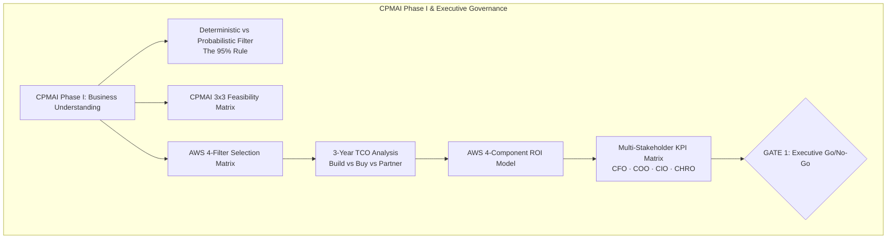

# David Maralack, PMP, PMI-CPMAI
##### **Senior Technical Program Manager | Enterprise AI Strategy | Cloud Solutions Architecture | Software & Hardware Delivery**
📍 Seattle, WA | maralackdavid@gmail.com | LinkedIn: https://linkedin.com/in/david-maralack-3898135/

---

### 🏛️ Executive Summary & Value Proposition

**Senior Technical Program Management Leader** with 20+ years of high-impact delivery across Amazon and Microsoft, specializing in the end-to-end orchestration of complex global software and hardware ecosystems (Alexa, Kindle, Windows). 

As a certified **PMP** (Project Management Professional) and **PMI-CPMAI** (Certified Professional in Managing AI), I bridge deep technical cloud engineering on **Amazon Web Services (AWS)** with executive business strategy and board-level financial governance. My approach translates probabilistic AI capabilities into defensible enterprise value, applying rigorous **3-Year Total Cost of Ownership (TCO)** models, **4-Component ROI frameworks**, and **CPMAI Phase Gate governance** to ensure AI initiatives scale safely, deliver provable returns, and align strictly with core business objectives.

---

### 🎯 CPMAI Business Needs & AWS Strategy Frameworks

My program delivery is anchored on the **Cognitive Project Management for AI (CPMAI)** framework and the **AWS AI Business Strategist** methodology, ensuring every AI investment undergoes rigorous business justification before code is written:

#### 1. CPMAI Phase I: Matching AI to Business Needs
* **Probabilistic vs. Deterministic Task Filtering (The 95% Rule)**: Before committing enterprise capital, proposals are screened against task predictability. If a decision tree or business rules engine covers 95% of operational cases, rule-based automation is deployed. AI is reserved strictly for probabilistic, high-variability pattern recognition (e.g., visual defect detection, unstructured natural language support).
* **CPMAI 3x3 Feasibility Assessment**: Standardized Go/No-Go evaluation across 9 traffic-light indicators spanning **Business Feasibility** (clear problem definition, leadership commitment, sufficient ROI impact), **Data Feasibility** (data availability, access, quality), and **Execution Feasibility** (skills, timeline, operational fit).
* **DIKUW Pyramid & 7 Patterns of AI Alignment**: Mapping business problems to the AI "Sweet Spot" at the **Knowledge** and **Understanding** layers of the DIKUW pyramid (Data, Information, Knowledge, Understanding, Wisdom) and classifying initiatives against the Seven Patterns of AI (Conversational, Recognition, Predictive Analytics, Hyper-Personalization, Patterns & Anomalies, Autonomous Systems, Goal-Driven Systems).
* **Trustworthy AI Governance by Design**: Embedding fairness, explainability (XAI), privacy, safety, transparency, and human-in-the-loop (HITL) safeguards into Phase I planning rather than treating governance as a post-deployment afterthought.

#### 2. Developing AI Strategies That Align with Business Objectives
* **4-Filter Use Case Selection Framework**: Ranking and prioritizing candidate initiatives against four non-negotiable criteria: **Business Impact** (metric movement), **Data Availability** (clean, accessible training data), **Organizational Readiness** (operational ownership and champion sponsorship), and **Strategic Alignment** (support for the 3-year corporate roadmap).
* **3-Year Build vs. Buy vs. Partner TCO Framework**: Evaluating vendor proposals past initial software license fees to model complete 3-Year Total Cost of Ownership (TCO). Incorporates upfront development, cloud infrastructure opex, and hidden operational costs (e.g., false-positive throughput losses on production lines) while enforcing 100% enterprise IP ownership pre-conditions.
* **Active Portfolio Governance & Transition Strategy**: Managing AI portfolios through evidence-based decisions to **Scale** (proven return, strong data flywheel), **Pause** (with strict 30/60-day condition deadlines), or **Terminate** (unpromising projects stopped, budget redeployed). Transition approaches are tailored to continuity risk via **Parallel Running**, **Phased Rollout by Line/Site**, and pre-defined **Rollback Triggers**.

#### 3. Measuring & Demonstrating AI Business Value
* **Pre-Launch Baseline Capture**: Establishing rigorous pre-launch operational baselines prior to deployment to ensure ROI claims represent verifiable evidence rather than speculation ("A KPI without a baseline is an opinion; a KPI with a baseline is evidence").
* **Multi-Stakeholder KPI Alignment Matrix**: Tailoring business value framing across executive perspectives:
  * **CFO**: Net Annual Savings, EBITDA impact, 2-Year ROI %, and Payback Period (~10-12 months).
  * **COO**: Scrap rate reduction, Overall Equipment Effectiveness (OEE) lift, and Mean Time Between Failures (MTBF).
  * **CIO**: User adoption rate, data pipeline uptime SLA, and system integration health.
  * **CHRO**: Recovered labor capacity and workforce productivity redeployment.
* **Comprehensive 4-Component Financial ROI Model**:
  $$\text{Net Annual Benefit} = (\text{Direct Savings} + \text{Indirect Gains} + \text{Productivity Gains}) - \text{Hidden Operating Costs}$$
  * *Direct Savings*: Tangible cost reductions (scrap reduction, reduced manual inspection labor).
  * *Indirect Gains*: Avoided downstream rework, customer complaint resolution, and expedited freight.
  * *Hidden Operating Costs*: Ongoing cloud compute, model maintenance, data science oversight, and re-training opex.
  * *Productivity Gains*: Hours recovered across operational leads and plant managers.
* **Leading Indicators & FinOps Cost Factor Controls**: Tracking early project health signals (User Adoption Rate, Data Pipeline Health, Executive Sponsor Engagement, Model Accuracy Trajectory) to intercept drift early. Implementing FinOps cost controls including compute right-sizing, 15% data sampling for experimentation, and 90-day obsolete model artifact retention.

---

### 🚀 Featured Enterprise AI Architecture Portfolio

Below are four production-benchmarked architectural reference implementations engineered on AWS and evaluated under the **PMI-CPMAI** and **AWS AI Business Strategy** frameworks:

#### 1. 🛡️ Permission-Aware AWS RAG Engine (Enterprise Knowledge System)
**Zero-Trust Retrieval-Augmented Generation Architecture with IAM RBAC Metadata Filtering**
* **Strategic & Business Alignment**: Evaluated under CPMAI Phase I for Tier-1 support operations. Achieves a 35% reduction in Average Handle Time (AHT) yielding **$1.8M in annual operational savings** with a **<12-month payback period**.
* **Architecture & Governance**: Enforces document-level AWS IAM Role-Based Access Control (RBAC) metadata filtering inside OpenSearch Serverless hybrid vector search, preventing cross-departmental data leaks. Powered by Cohere Cross-Encoder re-ranking, Amazon Bedrock (Claude 3.5 Sonnet), and automated CI/CD quality regression gates in AWS CodePipeline.
* **Measured Production SLAs**: **92.4% Retrieval Precision** | **1.38s P95 Response Latency** | **100% RBAC Data Isolation** | **96.1% Citation Coverage**.

#### 2. 🤖 Agentic Workflow Automation & Tool Governance
**Multi-Agent Tool Orchestration with Deterministic Human-in-the-Loop (HITL) Safeguards**
* **CPMAI & Governance Alignment**: Separates probabilistic LLM reasoning from state-changing database write operations. Enforces mandatory HITL approval for high-risk write actions (refunds, privilege modifications), delivering **$1.2M in annual risk avoidance**.
* **Architecture & Control**: Dynamic agentic planning via **Amazon Bedrock AgentCore** and **Model Context Protocol (MCP)** on AWS Fargate/Lambda, guarded by deterministic **AWS Step Functions** state machines.
* **Measured Production SLAs**: **95.2% Tool Execution Accuracy** | **100% Prompt-Injection Attack Blocking** | **100% HITL Policy Compliance**.

#### 3. 📊 Automated LLMOps Telemetry & Quality Guardrails
**Full-Stack Observability & Continuous In-Pipeline Quality Regression Gating**
* **CPMAI & Risk Alignment**: Protects enterprise SLAs and prevents silent model degradation by automatically aborting deployments if citation accuracy or hallucination rates exceed threshold guardrails (**$950K/yr risk avoidance**).
* **Architecture & Observability**: Real-time distributed tracing with **AWS X-Ray** and **Amazon CloudWatch**, paired with automated pre-deployment evaluation harnesses using **AWS SageMaker Model Evaluation** integrated into AWS CodePipeline.
* **Measured Production SLAs**: **96.1% Citation Accuracy** | **2.3% Hallucination Rate** | **1.42s P95 Latency SLA** | **100% Trace Coverage**.

#### 4. 🗣️ GenAI ChatBot - Afrikaans AI Companion
**Full-Duplex Multimodal Language Learning & Cultural Preservation Platform**
* **CPMAI & Pattern Alignment**: Maps to the **Conversational & Human Interaction** pattern and **Augmented Intelligence** framework to interact with Kaapse Afrikaans (Cape Flats) and formal Afrikaans heritage through ultra-low latency voice engagement.
* **Architecture**: Full-duplex WebSocket audio streaming pipeline integrating **Gemini Live API** with 16kHz PCM capture, Gemini 3.1 Flash Lite, Gemini TTS, and Google Veo video synthesis, hosted on Cloud Run.

---

### 🛠️ Strategic & Technical Program Management Competencies

| Competency Pillar | Specialization & Tooling |
| :--- | :--- |
| **Enterprise AI Strategy** | CPMAI Phase I Business Feasibility, AWS Module 4 & 5 Methodologies, Build vs. Buy vs. Partner TCO Analysis, Active Portfolio Governance (Scale/Pause/Terminate), Shadow AI Governance |
| **Financial & Value Governance** | 4-Component Financial ROI Modeling, Pre-Launch Baseline Capture, Multi-Stakeholder KPI Framing (CFO/COO/CIO/CHRO), FinOps Cost Factor Controls, Payback Period Calculation |
| **AI Architecture & RAG** | Permission-Aware RAG, Amazon Bedrock, OpenSearch Serverless Hybrid Search, Cohere Cross-Encoder Re-Ranking, Prompt Engineering & Guardrails, Vector Indexing |
| **Agentic Systems & Governance** | Amazon Bedrock AgentCore, Model Context Protocol (MCP), AWS Step Functions HITL State Machines, Deterministic Guardrails, Tool Execution Oversight |
| **LLMOps & Observability** | SageMaker Model Evaluation, Ragas Evaluation Framework, AWS X-Ray Distributed Tracing, CloudWatch Telemetry, Continuous CI/CD Quality Regression Gating |
| **Executive Leadership** | 20+ Years Enterprise Delivery (Amazon, Microsoft), Cross-Functional Stakeholder Alignment, PMP Agile/Waterfall Governance, U.S. Patent Holder |

---

### 📜 Certifications, Patents & Education

* **Project Management Professional (PMP)** | Project Management Institute
* **PMI Certified Professional in Managing AI (PMI-CPMAI)** | Project Management Institute
* **AWS Certified AI Business Strategist (AIB-C01 Specialization Track)** | Amazon Web Services
* **AWS & Cloud Specializations**: AWS Solutions Architect, AWS Data Lake Specialization, Google Cloud Advanced Data Analytics
* **B.S. in Computer Science & Mathematics** | University of the Western Cape
* **U.S. Patents**:
  * *Patent #8,683,579*: Software Activation Using Digital Licenses
  * *Patent #8,984,124*: System and Method for Adaptive Data Monitoring

---

### 📬 Connect & Collaborate

* 💼 **LinkedIn**: linkedin.com/in/david-maralack-3898135/
* 📧 **Email**: maralackdavid@gmail.com
